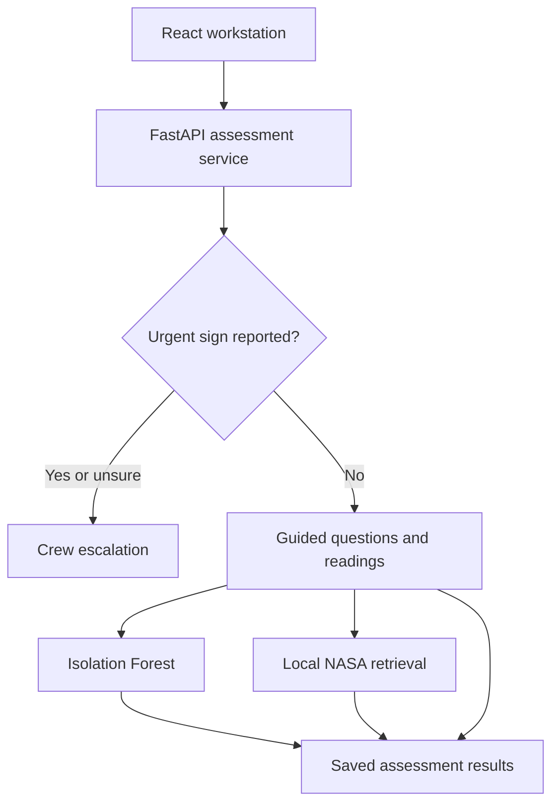

# Architecture

SQLite persists profiles, demo records, assessment sessions and answers, measurements, findings, and catalog entries. The assessment service controls progression and completion. Answers and measurement writes share a transaction. Escalation saves the answer and finding before returning an interrupted status. Repeating an identical answer returns current progress without duplicating a measurement. Completing an already completed assessment returns the saved result.

React Router routes the workstation with URL hashes. TanStack Query refreshes backend state, and Recharts draws charts from stored records. Vite builds locally bundled fonts and assets. FastAPI serves the production frontend and API together.
